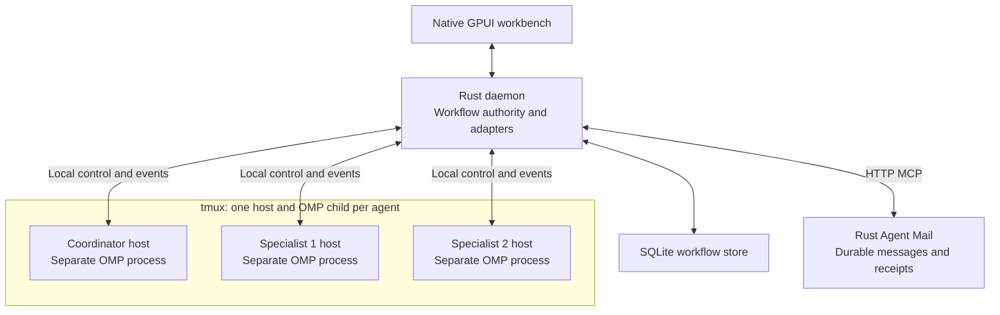

# Crewroom architecture

Status: shared design approved by the user on 2026-09-25, following the [product direction](product.md) and simple/complex workflow review. On 2026-09-27, the user approved incorporating the validated OMP, tmux, and Rust Agent Mail technologies into this architecture. The first live milestone and subsequent native port have revision-bound evidence in [status](status.md) and the [native release record](release-native.md). Historical experiment baselines below retain their original scope.

The operator's 2026-09-26 clarification fixes the process topology: one independent process per agent, with external monitoring and messaging. See [ADR 0004](adr/0004-observe-independent-agent-processes.md).

The [MVP build plan](mvp-plan.md) turns these boundaries and acceptance cases into ordered implementation milestones. Use it for current work, dependencies, and completion gates; this document remains the architectural contract.

**Intake extension, 2026-10-13 (FOR-10):** the existing daemon scheduler owns a durable intake request alongside the coding queue. An absent or stale accepted implementation plan starts one bounded Grill coordinator with pinned Git-object read/search only. Question and proposal tools persist a stop intent before returning; Waiting for you and Plan review require stopped ownership. Answers use the existing external steering delivery and attempt recovery. OMP replaces an interrupted intake session conservatively from saved context; usable native sessions retain their identity.

Plan versions and operator decisions are separate records. Acceptance can adopt proposed requirements atomically, then the scheduler closes stopped Grill and creates one coding successor in a single replayable handoff. Each new coding run and assignment captures its accepted plan; work packages confer no assignment authority. Repository preparation and admission check current requirements, repository configuration, target commit/tree and instructions independently of model eligibility. Existing admitted-run recovery and explicit PR-feedback Resume retain their prior contracts. See the [intake state and migration contract](testing/mh5-intake-contract.md).

## Shape

**Multi-harness direction, 2026-10-12:** the operator requested model-based specialist assignments with OMP, Codex and Claude Code execution. The [development plan](multi-harness-plan.md) defines the model-offering and resolved-route distinction plus real-runner acceptance for each adapter. The shared Rust runner interface retains OMP and adds native Codex (MH2) and Claude Code (MH3); metadata discovery alone does not establish a usable execution adapter. Preserve the single workflow authority and one separately supervised process per specialist.

**Runtime direction updated 2026-10-02:** the operator selected a full Rust port of the workbench and workflow service, with GPUI Kit for the native UI. [ADR 0009](adr/0009-rust-native-workbench-and-service.md) and the [migration plan](native-migration.md) define the staged cutover. The daemon stays separate from the UI, owns the store and execution, and authenticates the native client over loopback. UI closure is not an execution stop.

The repository default is the GPUI workbench and separate Rust service. The retained 0.1.0 React/TypeScript/Vite/Express implementation remains an explicit compatibility and matching-build rollback reference. Both services validate mutation origin/host; the Rust service additionally requires its private native-client credential. Credentials remain server-side. Use one durable workflow authority so a UI reconnect, coordinator restart, or runner replacement cannot create a second owner of the same work.

For the approved MH2–MH6 expansion, each harness supplies model access through its existing authenticated setup (operator clarification, 2026-10-12). Keep login/refresh server-side and isolate assignment configuration/session state. Preserve the OMP gateway route; native routes must declare which request/budget controls they can enforce and report unavailable accounting honestly. The [MH2 runtime contract](testing/mh2-runtime-acceptance.md) records native Codex configuration, restricted tool authority, durable receipt reconciliation and capability limits; the [compatibility spike](research/codex-mh2-compatibility-spike-2026-10-12.md) remains prior diagnostic evidence. The [MH3 runtime contract](testing/mh3-runtime-acceptance.md) records direct Rust Claude control, native-login ownership, SDK-only tool gating, alias/observed-model identity, conservative history recovery and list-price accounting.

Implementation boundaries:

| Boundary | Responsibility |
| --- | --- |
| Workbench | Ticket selection, coordinating conversation, specialist progress, controls, evidence, and connection state |
| Workflow service | Accepted requirements, assignments, ownership, scheduling limits, steering disposition, readiness, and recovery decisions |
| Durable store | Ticket source snapshots and independent refinements; workflow/assignment records; observations, evidence, and pending external actions |
| Runner adapter | Start, observe, resume, interrupt, and identify each coordinator/specialist process through a tested harness contract |
| Agent host | Own one OMP child's RPC connection, expose control and structured activity, and render its tmux view |
| Message service | Persist addressed agent messages, route across processes, and expose history and delivery outcomes to passive observers |
| Repository services | Owned checkout, pinned revision, actual command checks, and environment-specific test evidence |
| Provider adapters | Jira read/write reconciliation and Bitbucket PR/check observations with explicit external identities |

The coordinator is the ongoing lead agent within this design. Every Run enters through it before specialist assignment. It interprets requirements and results and proposes the next assignments; the workflow service records those decisions and enforces ownership, limits, and readiness against actual evidence. The coordinator is not merely a first dispatch step, and its statement that work passed does not replace executed checks or independent review.

SQLite is the durable workflow store, owned by the Rust daemon. The packaged app and service need no Node runtime. Retained TypeScript validation uses the recorded Node toolchain; target repositories keep their own independent runtime requirements.

The [reuse assessment](research/omp-team-reuse-assessment.md) records the selected historical mechanisms. Their native counterparts retain one workflow authority and the tested process, evidence and recovery contracts. The fixed old phase sequence, old model pins, global routing installation, and old runtime data are not adopted.

The [MH4 model contract](testing/mh4-model-contract.md) defines stable offering keys, explicit equivalence, durable metadata snapshots, shared preview/admission policy and immutable assignment selections. Discovery has no workflow authority; it runs as bounded owned processes outside execution lanes. Refresh and settings edits cannot change a captured route or resolve an ownership/effect hold.

## Selected runtime technologies

The following table retains the first-milestone experiment baselines. Current native executable and tool identities are bound in the [release record](release-native.md). [ADR 0005](adr/0005-use-omp-tmux-and-rust-agent-mail.md) records the decision; the [execution report](testing/rust-mail-results-2026-09-27.md) and [machine-readable evidence](testing/rust-mail-results-2026-09-27.json) identify the tested binaries, fixture hashes, processes, and results.

| Component | Tested baseline | Architectural responsibility | Validation boundary |
| --- | --- | --- | --- |
| OMP | 18.3.1 | One independent agent process per coordinator/specialist, controlled through RPC and host tools | Separate processes/sessions, structured activity, three distinct model/provider assignments, and explicit replacement from saved input passed; application interruption tests now cover contained tool work; bounded continuity and coding interruption recovery pass their application tests |
| tmux | 3.7c | Host an agent adapter in each pane and provide attachable terminal views | Pane/host/OMP parentage and viewer reconnect passed; pane exit does not prove all descendants stopped |
| Rust Agent Mail | v0.3.36 | External durable mailbox through its HTTP MCP API | Keyed retry after restart, concurrent duplicate handling, explicit acknowledgements, passive event cursors, and bounded retention were exercised |
| Crewroom backend and SQLite workflow store | Implemented through M3 | Authoritative runs, assignments, attempts, ownership, steering, model policy, evidence, and external-action reconciliation | Application host/mail, pause, ownership, bounded continuity and limits pass; local coding, revision evidence and browser results pass; live delivery remains M4–M5 |

These are tested version baselines, not claims about later releases. Record executable identity in run evidence and rerun affected contracts when upgrading a component.

**Harness version contract (FOR-69, accepted 2026-10-19).** Codex, Claude Code and OMP update themselves, so the exact-version gate is replaced for these three harnesses. The verified `--version` list stays the baseline (`verified`). An unlisted release newer than the oldest verified version, including a new major, is admitted only after a compatibility probe passes; the probe never sends a prompt and so requests no model inference. It runs in isolated HOME/configuration directories under the discovery process-ownership contract and checks, in order: the version parses in the harness's release format; model discovery returns parseable offerings (at least one for Codex and Claude Code; OMP may list none, because it lists models only from providers in the runner configuration, and the catalog keeps naming that missing configuration rather than reporting a probe failure); and the launch handshake answers with the attempt's launch flags — Codex's bundled model catalog plus an `app-server --strict-config` initialize with the generated attempt configuration, Claude Code's stream-json `initialize` control exchange with the SDK tool server and tool gate hook, and OMP's RPC `ready`/protocol-v2 negotiation, session state and host tool registration decoded with the runtime frame decoder against a synthetic loopback provider that is never contacted. A passed probe yields a receipt keyed by harness, exact version, canonical executable path and SHA-256; the catalog retains bounded receipts so a refresh of the identical executable skips the handshake, while any content change is probed again. The discovered identity carries `verified` or `probed` with its receipt; admission freezes it with the selection, and a native adapter starts only a listed version or the exact probed version and executable that selection recorded. If the executable changed between admission and launch, the launch re-probes it. A failure holds the launch and names the failed check; a new executable that no longer lists the admitted offering also holds it with that reason. A pass records the new executable identity and probe receipt on the attempt (with the admitted version and hash it replaced) and the launch proceeds; route, offering and effort stay as admitted, and the adapter checks the recorded identity against the executable it starts. Older, unparseable and probe-failing versions are refused with the harness, version, failed check and remedy. **Hardening (FOR-71, probe contract v2).** A health probe never triggers login, hooks, MCP servers or IDE setup: besides the isolated HOME/configuration and Claude Code's `--bare` (metadata) and `--safe-mode`/strict-MCP flags (handshake), every probe sets `ENABLE_CLAUDEAI_MCP_SERVERS=false`, `CLAUDE_CODE_AUTO_CONNECT_IDE=0` and `CLAUDE_CODE_IDE_SKIP_AUTO_INSTALL=1`, because in Claude Code 2.1.303 neither flag gates IDE auto-connect or extension auto-install. The Codex probe adds a `protocol-schema` check between the bundled catalog and the app-server handshake: `codex app-server generate-json-schema --experimental` describes the protocol offline, and its server requests and notifications are compared with a reviewed baseline (Codex 0.163.0, `model_catalog/codex_protocol.rs`). A server request that Crewroom neither handles (`item/tool/call`, `account/chatgptAuthTokens/refresh`) nor has in that baseline fails the probe naming the method; a handled request or a notification the runner relies on that is no longer offered fails it too; a missing or failing subcommand fails closed. Notification additions and removals are recorded on the receipt. A bundled known-broken list (`model_catalog/known_broken.rs`: harness, inclusive version range, reason, review reference) refuses a release before any probe process starts, even when its probe would pass; such a version is never launchable, and the native adapter and launch refuse it too. The list changes only with a reviewed Crewroom revision and is never fetched, configured or reduced to a warning. Every launch, including resume and process replacement (both launch the replacement attempt, which carries the frozen selection, through the same path), compares the executable with the recorded identity and probe receipt: a changed executable, or a probed admission whose receipt no longer satisfies the current probe contract, is re-probed, and a failure holds the launch with the reason. Contract v2 invalidates v1 receipts, so those versions are probed again. The model selectors used in the scripted tests are fixtures, not permanent role defaults or proof of live provider availability. Role/model policy stays in user configuration, with requested and resolved settings recorded per assignment.

**Harness capability record and model catalog (FOR-73, 2026-10-19).** What a harness version supports is a typed record ([`model_catalog/capabilities.rs`](../crates/crewroom-runtime/src/model_catalog/capabilities.rs)), not prose. Capabilities: host tools, steering a running turn, interruption, session resume, effort control, token accounting, request counts, cost and pre-request budget. Each is `verified` (live acceptance on this exact verified version), `probed` (exercised by the FOR-69 receipt: host tools after the handshake, effort control after model discovery), `estimated`, `unverified` or `unavailable`. A probed version claims nothing its probe did not exercise. Every capability that is not usable has one fallback: host tools and effort control refuse admission; steering is held until the agent is idle; interruption, resume and the accounting facts run in a stated degraded mode (pause/stop end the process, a replacement starts a fresh session from Crewroom's durable record, usage/cost/budget are reported unavailable or estimated). Admission adds refusals to the eligibility predicate and freezes the record with the selection; a passing launch re-probe replaces it with the new version's record; launch and steering delivery read the frozen record. Routes admitted before FOR-73 keep the verified baseline; an unreadable frozen record claims nothing. A reviewed bundled model file ([`bundled-models.json`](../crates/crewroom-runtime/src/model_catalog/bundled-models.json)) is compiled in and changed only by a Crewroom revision; it is never fetched. Live discovery decides availability; the file fills capabilities discovery leaves unreported, records current/legacy status, and names the Codex or Claude Code release that lists a reviewed model the installed version predates (information only; OMP lists by provider, never by release). On refresh, the service also lists the operator's OMP login (`omp models --json` in the service HOME), keeping only identity and capability fields. Those models are launchable only through a runner-configured API-key provider; every other login model is listed with that reason. No credential is read, stored or displayed.

The diagram shows two specialists as an example; the accepted limit remains up to three compatible specialists plus the coordinator. The native GPUI workbench is the main operator interface. tmux adds direct process visibility, while the workflow remains independent of the terminal layout. NTM is not part of this stack. Relaycast remains historical comparison evidence; a custom mailbox is deferred unless existing services fail a required contract.

## Agent processes and communication

The workflow service supervises a separate OMP process for the coordinator and for every specialist. Each has its own conversation, process identity, and observation/control connection. A host adapter in each tmux pane owns that OMP child's RPC pipes and exposes local control and activity to Crewroom. Use a Crewroom-owned tmux socket/session. Creating hidden in-process OMP task agents does not satisfy this contract; OMP's native team bus is excluded from Crewroom communication.

Agents invoke addressed send/reply host tools, which Crewroom routes through its Rust Agent Mail adapter. Crewroom records logical message identity, sender, recipient, run/assignment/attempt, reply relationship, and delivery disposition, retaining the mailbox's transport identity. Rust Agent Mail owns the stored message body and mailbox receipts; Crewroom owns their meaning for the workflow. Specialist-to-specialist exchanges use this same boundary. Crewroom can inspect the full exchange while the coordinator receives relevant findings and decisions without carrying every peer message in its prompt. A mailbox receipt does not establish completed work.

The host derives sender identity from the admitted process/attempt; the backend validates the recipient and scope. Keep mailbox credentials server-side and bind the message service to loopback. Disable Rust Agent Mail's ATC operator so Crewroom remains the only workflow authority. The tested adapter uses HTTP MCP and OMP host tools; do not deliver agent messages with `tmux send-keys` or require models to poll their inboxes repeatedly.

Persist outbound intent and its stable logical ID before sending. Retry with the same key within the configured retention window; the tested normal setting is 24 hours. After that window, reconcile the saved transport identity and actual mailbox state before retrying. An expired key can create a second message, so mailbox deduplication is not an unlimited or exactly-once execution guarantee. Retain recovery inputs and referenced artifacts for the required lifetime of their run.

Persist inbound acceptance and a recoverable input reference before acknowledging mailbox delivery. Dispatch through the host only when the recipient's workflow state permits execution. A paused recipient retains queued mail without a model turn; busy-agent steering follows the runner's tested control contract. Saved, dispatched, runner-received, applied/rejected, and completed work remain separate observations. The M2.4 application tests establish durable dispatch/receipt reconciliation, busy steering, and continuation; see [continuity results](testing/continuity-2026-09-27.json).

Provide a live view for every process: assignment, model, current process/session identity, output, tool activity, last observed activity, and exit/failure state. Capture observations outside the agent so monitoring remains useful if that agent or the coordinator stops responding. The operator can inspect messages and logs without consuming the recipient's unread or acknowledgement state. Process liveness, agent-reported progress, and evidence of completed work remain separate facts. Terminal views can supplement this interface; terminal input is not the assumed message transport.

Use Rust Agent Mail's `fetch_inbox_events` with a separately persisted observer cursor. When fetching message bodies for observation, use `mark_read=false`; ordinary inbox fetches otherwise change read state. Expose a read-only observation boundary through Crewroom rather than handing the mailbox's service credential to the browser. The tests establish non-consuming reads, not production observer authorization.

The validated OMP mode uses RPC with `--no-ui`. tmux panes render the host's structured activity; simultaneous native OMP TUI access is not established. Persist activity independently of terminal scrollback so browser or terminal reconnects can recover observations. A tmux client detachment is distinct from a host, tmux server, or machine failure.

**Visibility direction, 2026-09-28:** the operator accepted a live terminal wall over a push channel; see [ADR 0007](adr/0007-live-agent-wall-over-push-channel.md). Renderer adoption awaits the R3 spike. Rendering changes must preserve this section's process, control, messaging and durable observation contracts.

Process replacement preserves the logical agent/assignment identity but records a new process generation and attempt as appropriate. Reconcile retained ownership, pending delivery, and potentially live descendants before allowing a replacement to execute. A PID alone is not sufficient identity. Separate processes do not themselves provide filesystem isolation, durable delivery, or recovery; those remain independent contracts.

Repository command execution now uses the boundary in [ADR 0006](adr/0006-contain-repository-commands.md): one Docker container per admitted command, controlled through a private local engine socket. The M2.3 native detached-child failure ruled out process groups and inherited locks as sufficient proof for arbitrary command descendants. OMP native tools remain disabled; the host admits configured commands and persists container identity before execution. Engine uncertainty blocks replacement. This adds a configured Linux image to the check environment while retaining separate observable native OMP processes.

## Records and ownership

Approved domain boundaries:

- A **run** is the durable effort toward one selected ticket outcome. It retains history through pause, recovery, inserted specialists, and permitted continuation.
- An **assignment** is one specialist responsibility within that run, with inputs, expected output, dependencies, and an owner.
- An **attempt** is one execution of an assignment. Retry or replacement creates a new attempt and preserves previous evidence.

Record Jira site/stable issue identity separately from its display key. Importing source fields never overwrites local refinements, steering, or run history. Repository configuration identifies the target checkout/remote, target branch, project rules, validation requirements, and Jira source; it is separate from a Jira project.

Snapshot the accepted requirements, applicable project instructions, selected role definition, and model assignment used by each assignment. Evidence also records the code/base revision, execution environment, producing attempt, and actual check or review result. Editing requirements or a role definition does not silently rewrite historical assignments.

Each coding effort owns an isolated worktree, with up to three compatible specialists and one writer per worktree. **Per-project capacity (FOR-76, operator decision 2026-10-19; replaces the single workspace coding slot):** the native store keeps one `coding_slots` row per holder, keyed by run, with the ticket (`UNIQUE`) and project (the ticket's target repository). `execution_settings` holds each project's capacity (default 1, at most 16) and an optional workspace ceiling. A run occupies capacity while it holds a slot (until review release, merge, cancellation, or a pause that confirms every attempt stopped) or while any attempt's ownership is not confirmed stopped, so a paused run with unconfirmed ownership keeps its slot. `Store::release_paused_coding_slot` frees the slot (`slotRelease.reason = "paused"`) when a coding run is paused in both desired and actual state with every attempt admitted-only or ownership `stopped`; it runs at pause completion (`finish_pause`) and from the scheduler for each holder. Review-gate pauses (`review`, `validation`, `merged`) keep their own release, and comparisons keep their slot until the result is committed. Resume of a run released this way reclaims a slot through `reclaim_coding_slot` (clearing the release marker), or, when the project is full, queues a `resumeRequest` that keeps priority over new plans in that project. Admission is checked under the store's `BEGIN IMMEDIATE` lock at three points: claiming a slot (`claim_next_coding_slot`, `claim_coding_slot`, `reclaim_coding_slot`), the supervisor's in-memory admission reservation, and attempt claim (`Store::execution_conflict`). Over capacity, a queued plan gets the hold reason ("Waiting for a slot in <project>: n of n running" or "Waiting for a workspace slot: …"); a manual Start of a queued plan records a `startRequest` with the preflighted team instead of returning a conflict. The scheduler handles every holder, gives released review-ready runs priority within their project, re-runs readiness work only for plans with room, and claims slots in queue order until no project has room. The atomic ticket claim is enforced twice: the unique ticket column of `coding_slots`, and attempt claim (and the supervisor reservation), which refuses while another run of the ticket has an agent whose ownership is not confirmed stopped. Within a run, one attempt per assignment and coordinator replacement after a rebrief are unchanged. Neither conflict retries; recovery re-attaches. A comparison (evaluation) run needs every slot free and blocks all others. Schema 36 migrates a retained single slot to its project row. The legacy TypeScript server keeps its retired one-ticket policy (`server/execution-policy.ts`) and is not the product runtime. Process ownership, admission reservations and host authorization are otherwise scoped per run. Each agent host binds an OS-assigned loopback port before OMP starts, unless the runtime configures a port pool (used by sandboxed tests). Review and verification inspect a known stable revision. Runtime ownership must survive process-parent failure without allowing an orphaned worker and a replacement to write concurrently.

## Instruction comparisons

FOR-14 adds an optional comparison through the existing role, principle, playbook and Learning editors. The [comparison contract](testing/for-14-comparison-contract.md) freezes both instruction snapshots, the applicable consumer, composed assignments, case/check bytes, model route, executable identities and active-time bounds before explicit Start. Only the target instructions differ. A playbook treatment reaches the coordinator; a role or attached principle reaches the evaluated specialist.

The existing daemon admits comparison cells serially through the same slot and stopped-ownership gates as coding. Each cell has an internal task/run, one coordinator and one evaluated worker in separate observable processes, using external Mail. These internal records are excluded from the ordinary ticket queue. Evaluation tools expose scoped source reads/edits, protected contained checks, fixed-team messages and a structured handoff. They cannot publish, modify catalogs, create coding evidence or satisfy readiness.

Fixture workspaces are private materialized source trees, identified by canonical path/content manifests. They are not Git candidates or publication worktrees. Protected check code is readable but remains outside the worker's writable source; independent final checks execute after workers stop. Results distinguish source correctness, actual worker verification, completion claims and unfinished coverage. Prior checks remain historical. This uses the same revision-binding principle as coding without inventing Git commits for disposable fixture files.

Pause and restart retain cell allowances, manifests, attempts and results. Frozen runtime drift holds the comparison without fallback. Durable finalization binds the stopped handoff source before scoring; recovery finishes that record instead of launching another worker. A completed comparison supplies optional evidence for the existing revision-checked Save or Approve decision. It never adopts instructions or rewrites admitted assignments.

## Supervision and recovery

One coordinating conversation receives operator steering. Persist each instruction before dispatch, and retain distinct stored, delivered, and applied observations. Application means the instruction has been reconciled into the work plan or an explicit response; it is not proof that its requested code change is finished.

Record steering transition times without inventing missing legacy times. Plain coordinator replies do not establish application; an authenticated applied/rejected disposition also confirms receipt when the host response was lost. Cancellation, refinement closure and research completion settle only still-pending messages as not delivered. Dispatched input keeps its uncertainty until the existing host journal proves receipt or stopped non-dispatch. Version-24 migration settles legacy terminal pending messages with an unknown settlement time. Completed research can reopen through explicit requirements adoption: a previously undelivered message remains in operator history, while continuation prompts carry only its identity and disposition, never its instruction body. The operator can send fresh steering after reopening.

Pause stops new assignments and requests active work to stop safely. Report pausing until the adapter can establish stopped execution; reconcile any uncertain external effects. Cancel prevents further execution and preserves artifacts rather than deleting or reversing them. A closed browser does not itself prove an agent stopped. Service restarts reconcile existing ownership and progress before scheduling another attempt.

Inserted specialists receive explicit assignments and dependencies at a coordination point. Their findings can create further work or invalidate affected evidence. Changes to scope follow the operator-decision rule. No specialist or selection adviser may waive the readiness requirements.

Automatically continue completed known progress and resume usable sessions. Replacement specialists receive the accepted requirements, decisions, steering, current work, completed evidence, and outstanding work. Allow two automatic repair/replacement cycles per blocked assignment. Unknown ownership or unresolved external outcomes require operator attention without another potentially duplicate action.

OMP can expose first-turn input through RPC before persisting it in its session file. Recover from Crewroom's saved input/mailbox reference when that session is unusable, recording a new attempt/process/session rather than assuming session restoration succeeded. The M2.4 application test demonstrates automatic first-turn replacement after confirmed termination. Unknown effects block continuation; confirmed retained messages are reconciled with their original keys. A dead pane or expired ownership token alone cannot authorize a replacement writer: reconcile the old OMP process and tool descendants first.

The implemented runtime restores a usable session from a stable assignment working directory, retaining separate per-attempt process/configuration records. Host input IDs correlate with OMP prompt results. Replacement context carries prior inputs, steering, confirmed mail and tool progress. A newer cancel supersedes a pending resume, and model-policy violations stop for attention without consuming automatic recovery cycles. Repository checkpoints and revision evidence now pass M3 local acceptance; see [coding results](testing/coding-2026-09-27.json).

Persist the active-execution time used by a run so restarting it cannot reset the budget. The initial limit is 60 minutes and is configurable. Exclude time waiting for operator decisions or hosted CI. Request a safe pause when the limit is reached; retain pausing/uncertain state until execution is actually controlled. Usage or cost can be actual, estimated, or unavailable; do not infer zero cost from missing data or claim an enforceable monetary budget without reliable accounting. Each host's provider gateway records one usage receipt per upstream response: the provider's own token report, or the reason it is unavailable (interrupted, failed status, or no report). The workbench shows these per attempt; cost remains OMP's runner-pricing estimate.

## External operations

Persist intended Jira/PR writes before sending them. Track external identity and acknowledgement independently of local intent. Following interruption, inspect the provider's actual state before retrying an action whose outcome is unknown. The OMP archive's publication reconciliation and lost-reply tests are useful source material; Jira needs its own validated implementation.

The delivery reporter may update Jira status, milestone/blocker comments, and PR/evidence links. Requirement fields change only on an explicit operator instruction. During a Jira outage, retain pending updates and continue an already accepted brief. Conflicting refreshed requirements pause affected work for a decision.

the pilot repository's Bitbucket PR may be created with validation pending. Readiness requires applicable local/hosted checks and independent review covering the relevant current revision. Preserve unavailable, running, skipped, failed, and passed observations distinctly. Human merge remains outside automatic execution; verified merge is what releases dependent work.

A changed target branch makes readiness stale. Refresh is operator-initiated and requires stopped ownership, no requested completion and reconciled publication receipts; admission checks run before fetching and again inside the durable transaction. A new publication-backed request fetches into its own immutable `refs/crewroom/<run>/refresh/<request>/target` snapshot. Replays never refetch; rejected staging refs cannot move the accepted base/ref or any retained conflict snapshot. An unchanged target OID (regardless of ref name) records a completed receipt on the new request bound to the existing candidate, without rebasing, creating a candidate/checkpoint or sending a target-moved notice. A reasoned operator retry of an eligible held conflict atomically records its unchanged receipt and supersession, retaining the old workspace, branch, PR, candidate and stopped ownership without claiming readiness. Exact replay returns the historical outcome even after the remote advances or a newer hold; an older incomplete candidate association is recovered before evaluating a distinct new request. A real rebase advances the accepted base and target-ref pointer together only on verified completion; it creates a candidate whose checks and review must be renewed. The pinned ref proves fetched history integrity, not remote freshness: immediately before ordinary rebase completion or isolated promotion/recovery, observe the configured live target without modifying the snapshot. An unavailable or changed remote retains the original branch/PR and hold. Publication separately rechecks the remote target before delivery.

On a rebase conflict, keep the owned branch and PR unchanged and retain a run-owned isolated worktree. After explicit Resume, the coordinator may grant one writer only for recorded in-scope conflict files. A stopped completion promotes only if accepted requirements, project instructions, source-file scope, original branch identity, pinned snapshot and live target still match. Instruction conflicts, changed requirements, rewritten targets or unknown/out-of-scope Git state require operator attention. New per-request snapshots keep the accepted target ref stable through a second conflict; raw repository status does not pretend the unpromoted target is an accepted base. Historical records using the legacy shared `refs/crewroom/<run>/target` may still exhibit raw base drift: only their active, unsuperseded conflict bound to the exact source candidate, original clean branch, accepted scope, isolated workspace and fetched target may cross that narrow difference. The accepted base advances only after stopped promotion. Conflict continuation rejects an unresolved marker block without treating a legitimate standalone `=======` line as a conflict.

An isolated conflict workspace in `preparing` is not a settled conflict: worktree creation or its rebase may still have a surviving child. Neither a new controller nor an operator retry reconstructs or inspects it as writable. Before `git add`, a resolver records `continuing` with its writer attempt, tool-call ID, refresh ID, workspace identity, source head and exact paths. Only a returned Git command followed by workspace and source validation may atomically record a stable `conflicted`, `ready` or `operator_required` outcome and a replay receipt. A timeout, unknown child or interrupted continuation stays `continuing` for operator inspection; a replay of an older tool-call ID cannot advance a later conflict step. No writer or Resume falls back to the original checkout while either barrier exists. Version-23 migration keeps v22 `preparing` work intact and converts an ambiguous v22 `conflicted` or `operator_required` workspace to a nonretryable `continuing` hold labeled “Legacy Git ownership unverified”; the legacy data cannot distinguish a stopped Git child from an orphan. Only an `operator_required` workspace with one exact rejected checked-promotion completion, matching refresh/source/operation IDs, expected target and immutable checked-process descriptor and command digest stays eligible for an explicit reasoned retry. A label, `toHead`, unrelated rejection or missing descriptor never proves that exception. The old stable `ready` workspace remains usable under its existing ownership/validation gates; `promoting` retains separate checked-process reconciliation, and completed `promoted` history remains historical. Supersession preserves F→R artifacts but never hides an unknown old Git child: its run remains held for writer, Resume, retry, evidence, publication, recovery and workspace cleanup even if a newer attempt completed. Cancelled/completed lifecycle intent is preserved rather than rewritten by migration.

The narrow v22 terminal-rejection exception also verifies the checked operation's persisted seal and, when present, its launch manifest against the recorded digest. A matching label or completion record without the exact seal is not evidence that the one-shot Git mutation stopped.

A safely undone superseding retry that stopped before target verification becomes a workspace-less `conflicted` operator hold with `holdReason: interrupted_retry`, no conflict paths, no candidate and the original supersession links intact; an ordinary safely undone refresh stays `interrupted`. Both kinds persist that their awaited Git rebase returned before rollback, persist `undo_started` before abort/reset and record `restored` only after a clean original-branch verification. A reopened `rebasing` record with missing rebase-exit evidence or `undo_started` performs no Git mutation or completion, even when HEAD is unchanged and Git reports no rebase in progress: a child may survive controller death and mutate later. The record retains the source and workspace with operator attention and blocks retry, Resume, writers, checks and publication. A new request ID and reason naming a positively restored active retry hold are required for another current-target attempt. Version-22 migration still normalizes legacy `interrupted` superseders before exposure, preserving explicit successor chains and retained workspaces; contradictory links or recovery artifacts fail closed. Ordinary `execFile` Git mutation has no crash-durable child-owner receipt, so a controller crash before its returned-command observation cannot be certified stopped from HEAD, metadata, a diagnostic Git read or the new controller lock. Neither interruption nor migration infers current-target resolution from timestamps or HEAD.

If the live target is positively observed at a different commit before the original branch moves, the controller can reject that exact requested conflict completion only after proving the original branch remains attached, clean, and at its recorded source head, the isolated resolution still matches the request, and all agent/Git mutation ownership is stopped. The completion receives a terminal `target_changed` receipt with both target commits and a timestamp; the same transaction retains the resolved workspace as `operator_required`, clears only its matching coding transition, and records one operator-attention notice. A keyed replay returns the rejected receipt and can never promote or create a candidate, even if the target later returns. A new request needs an explicit reason naming the held refresh; the original branch, PR, accepted base, and previous evidence stay unchanged until the new attempt succeeds. An unavailable target, corrupt snapshot, dirty or already-moved original, or uncertain ownership cannot establish this rejection and instead remains blocked for inspection. A refresh already completed before candidate association is not reclassified when the remote moves later.

Before any launch root or `launch.json` is created, a `promoting` intent atomically records the exact versioned checked-process descriptor: one immutable Git command/environment, source worktree, target commit, random one-shot token/root, digest, and controller epoch. A historical orphan prepared root from a pre-intent attempt cannot block a new token or be mistaken for the saved process. Only the admitted checked child may run `git reset --keep --no-recurse-submodules` on the original branch. Restart reconciliation seals a missing manifest or a prepared delayed helper under the operation lease before claiming it never executed; a malformed manifest, live holder or uncertain lock remains held. If the checked operation is proved stopped and the original branch and isolated resolution are still exact and clean at their recorded source, a positively observed moved target yields terminal `target_changed`; an unchanged target yields terminal `promotion_interrupted`. Both retain the workspace as `operator_required`, clear only the matching completion transition, and permit a *new* reasoned target request, including when the target is unchanged. The old completion never replays. A stopped executed reset with exact clean resolved head, worktree hash and source scope finishes local promotion once without inferring success from an absent crash-durable exit code; a subsequent changed/unavailable live target marks that run stale for attention before publication. Partial Git changes, uncertain process ownership and legacy versionless promoting records remain held, regardless of HEAD. Local promotion does not push a PR or establish readiness: recorded completion/continuation and fresh checks/review remain separate, and publication retains its current-remote gate.

The checked promotion descriptor records the Git executable path at admission. Compare it to the current PATH Git only before a new launch; recovery and terminal rejection authenticate the immutable recorded descriptor and manifest even after a Git upgrade. A stopped Git child still has no crash-durable exit receipt, and an unauthenticated orphan cannot be safely killed; uncertain ownership remains held for inspection.

Before publication, the operator can correct a pinned check image on a confirmed paused run after outstanding command ownership is reconciled. Record the reason, previous and replacement image, and a retry identity. Preserve earlier check/review receipts; require evidence and independent review for the corrected environment. This operation cannot remove checks, make them optional, or change their command/limits. Agents cannot amend their own validation policy.

PR comments remain associated with the ticket. The operator selects Resume to admit feedback work; continue the existing owned branch/PR and retain prior history while collecting fresh evidence. Provider observations can revoke readiness when a required check newly fails without starting another agent automatically.

### M6.3 Slice 3 failure model

Planning contract, 2026-10-01; implemented and accepted at `ad4c44a` ([acceptance record](testing/mvp-progress.md#m63-slice-3--pr-feedback-continuation-accepted-2026-10-01)). The [bounded slice plan](mvp-plan.md#m63-slice-3--pr-feedback-continuation) owns scope, acceptance, and repair limits. Use the existing run, queued Resume, writer ownership, candidate evidence, and publication-reconciliation contracts; extend only their feedback-continuation boundary.

At explicit Resume, bind the continuation to the run, existing PR/owned branch, source candidate, and observed feedback identity. Retain the input and outcome across restart. Later comments remain observable; they do not silently rewrite the captured assignment. Feedback that changes accepted requirements uses the existing operator scope/adoption path.

| Failure class in scope | Required behavior and bounded evidence |
| --- | --- |
| Feedback read fails, is partial, or repeats/arrives out of order | Retain the last known feedback and its provenance; expose unavailable/incomplete state, deduplicate known observations, and preserve newer known state. A read never admits execution. Test one repeated/stale observation and one failed/partial read. |
| Resume is repeated, queued, or interrupted before coordinator handoff | One durable logical continuation remains tied to its captured inputs. Reconcile handoff using existing control/message receipts; replay cannot admit a duplicate writer. Test restart at the new durable intent/handoff boundary. |
| Controller or writer stops during feedback work; cancellation or newer control wins | Preserve edits and captured input; use existing ownership and control-revision checks before continuing. Unknown ownership remains held. Add a targeted integration assertion at the new continuation boundary; reuse the established crash/process suite. |
| The feedback revision is ready locally but push/PR-update response is lost | Preserve the same PR and reconcile the recorded candidate/head and delivery intent. Retry only on established non-application; unknown remains held. Test one lost-response replay without duplicate PR creation or stale evidence reuse. |
| Source/target identity changes, PR closes/merges, or required evidence fails | Use current identity/evidence gates; retain work and report the block. Existing target-refresh handling remains authoritative. Exercise the continuation consumer and reuse unchanged provider/drift regressions. |

Known limitations: automatic termination of unverified Git children, generalized process recovery, remote comment replies/resolution, and a general provider event system are not promised here. Safe operator holds satisfy uncertain-ownership recovery; they must state why progress stopped. A missing failure-model row cannot waive an already accepted data-preservation, ownership, or truthful-evidence invariant. A demonstrated violation receives explicit scope triage before another repair; an unrelated failure class with those invariants intact is recorded as follow-up work.

### M6.4 Slice F failure model

Planning contract, 2026-10-01. Cancel remains terminal; an explicit keyed *Continue later* action queues a separate linked coding run. Admission reuses the continue-branch request and single coding slot. The cancelled source already has a checked-out worktree, so generic branch admission alone cannot perform this flow. Transfer its existing worktree through one durable store transaction after stopped ownership and exact recorded head/content checks. Do not remove the source worktree or manufacture a commit to move dirty edits. Keep source attempts, requirements, messages and evidence attached to the source run. The successor captures the current accepted ticket revision and fresh role definitions at admission; it receives no passing evidence from its predecessor.

| Failure class | Required behavior and evidence |
| --- | --- |
| Cancel overlaps execution or Resume | Desired Cancel supersedes further execution; pausing/attention remains visible until ownership is established. Retain work, process history, evidence and PR. Reuse the safe-stop process contract; test the operator control and stopped transition. |
| Continue request repeats, races, or loses its reply | One transaction records the successor and both history links with a request receipt. Replay returns that successor, including after restart. Another key cannot fork the same cancelled run. |
| Queue waits or controller stops during admission | No writer starts while queued. Recheck source ownership, expected head/content, captured repository and live PR identity at admission. Transfer is a store-only atomic handoff; restart can reuse it without moving/deleting Git files. Cancellation of the successor prevents launch. |
| Source work or external identity changes | Moved head/content, unresolved agent/check/Git ownership, unfinished target recovery, ambiguous delivery, a closed/merged PR, or unavailable provider verification holds/refuses with a reason. No automatic orphan termination or adoption of an externally changed branch. A source without owned work offers an ordinary new-branch run only. |
| Successor reaches publication | Fresh candidate checks and independent review are mandatory even for unchanged code. Continue the same publication marker, branch and PR; keep old evidence historical. Reuse publication intent/reconciliation for lost responses. A later closed PR or remote change blocks writes. |

The bounded slice does not add a runner, generic process recovery, PR merging, or cross-repository continuation. Unresolved target-conflict work remains retained for operator inspection rather than being silently copied into another run.

### Pair and package execution (MH6)

New coding admissions capture execution policy 1 and launch the coordinator first. The coordinator proposes a revisioned schedule covering the immutable accepted plan's packages; the existing service then admits each stage with current role/model proofs. The core choreography module owns coverage, lifecycle, exchange, report and review-independence rules. Schema 29 appends snapshots with compare-and-swap revisions and keyed receipts; proposals never reserve processes. Operator-inserted assessments remain read-only and use the existing insertion/retirement readiness gate.

A writing contributor requests a named package checkpoint before the next contributor edits. The existing whole-run stop reconciles processes and external messages, then the existing Git completion marker captures the exact source. Checkpoint completion creates no candidate. The named successor still needs normal admission and the coordinator's writer claim. Only completed package obligations, delivered pair dispositions and documentation closure permit final freeze. Candidate identity includes the choreography and plan binding; changed obligations invalidate readiness. Reviewer checks exclude every pair/contributor assignment and session, including retired history.

Successor schedules retain prior decisions and identify affected completed packages. They cannot rewrite admitted briefs or grant automatic rework. A current authorized writer claim is still required before reopening an affected package; PR feedback still waits for explicit operator Resume. Admitted legacy runs retain their prior policy. See the [pair and package contract](testing/mh6-pair-contract.md) and [validation record](testing/mvp-progress.md).

## Historical validation and first-milestone integration contracts

The [first contract experiment](research/omp-contract-experiment.md) passed 13 retained mechanism cases and a partial real RPC control probe. Later [Relaycast experiments](archive/omp-external-roundtrip-experiment.md) established the separate-process message path, and the [offline suite](testing/results-2026-09-26.md) exposed its restart-deduplication gap alongside OMP persistence and effort-normalization behavior. Those historical results retain their original scope.

The selected stack passed [14 distinct checks](testing/rust-mail-results-2026-09-27.md): nine real Rust Mail checks and five OMP/tmux checks. They cover the four-hop exchange, different model assignments, viewer reconnect, non-consuming observation, keyed-send and acknowledgement recovery, held dispatch, and explicit first-turn replacement. One check characterizes expired retry keys. Scripted providers establish interface/routing behavior, not remote model quality or availability. Preserve these executable checks as regression gates when building the application adapters; do not repeat technology selection merely because implementation remains.

The pre-M1 integration checklist was:

1. Implement durable workflow/host integration, including strict model and effort preflight. Record requested/resolved settings and enforce assignment policy before admitting work; OMP normalization must not silently satisfy an exact setting.
2. Exercise supervisor restart while hosts survive, host/tmux-server failure, stale-attempt rejection, and descendant reconciliation. Demonstrate a safe pause during a real child-tool command and prevent simultaneous old/replacement writers. Verify busy-agent steering and bounded automatic recovery against saved progress and uncertain effects.
3. Exercise mailbox storage/archive failures, retention expiry reconciliation, and recovery inputs across the required retention period. Implement browser observation authorization and event replay without consuming agent mail.
4. Adapt the retained ownership/evidence/publication mechanisms and fault cases into the actual workflow, then run a disposable coding job with real local edits, required checks, independent revision-bound review, and simulated lost Jira/PR replies.
5. Inspect the selected Jira source and Bitbucket repository read-only during onboarding. Establish exact issue/repository identities, transitions, and required check policy, then execute the live the pilot repository pilot with the minimum workbench and the evidence below.

Run the repository's required checks for implemented changes, including Crewroom domain/build/browser checks and the applicable the pilot repository gates for pilot work. The checklist above records the original integration scope. The [progress record](testing/mvp-progress.md) records its subsequent implementation and live M5 delivery; the [native release record](release-native.md) records the completed native port and its separate bounded evidence. These historical requirements do not reopen completed work.

## First-milestone acceptance cases

The [offline test strategy](testing/strategy.md) maps these capabilities to 87 specified behavior cases, 12 synthetic end-to-end scenarios and explicit OMP model-assignment fixtures. It separates domain tests, process contracts, actual independent OMP processes with scripted loopback model responses, and browser journeys. The [initial execution results](testing/results-2026-09-26.md) record passing scaffold, identity and selected recovery contracts, five adapter-policy failures, and missing product services. The subsequent [Rust Mail/tmux results](testing/rust-mail-results-2026-09-27.md) support the selected runtime without certifying complete Crewroom workflows or substituting for the live pilot evidence below.

The pilot uses one selected the pilot repository coding ticket and records the exact ticket, requirements, source revisions, role/model snapshots, runner version, check environments, and PR head/base. Its proof must distinguish live observations from simulated external-boundary fault tests.

| Case | Required evidence |
| --- | --- |
| Jira intake and execution | Read the real selected ticket, assign it explicitly to the pilot repository, preserve imported fields and local refinements, and start only after Run |
| Specialist selection and progress | Show actual assignments and observed activity; demonstrate the selected specialists without presenting queued plans as running agents |
| Independent processes and messages | Distinct coordinator/specialist processes; externally visible output, tool activity, and addressed message receipts; passive observation does not consume delivery; one specialist failure leaves other processes observable |
| Supervision and insertion | Persist a steering instruction, observe its receipt and disposition, insert a specialist, and reflect any changed work or validation need |
| Pause and resume | Confirm workers actually stop before showing paused; retain and continue the same durable work history |
| Interruption recovery | Exercise a real runner interruption and a local service restart, preserve existing edits/receipts, reconcile ownership, and resume or replace without repeating completed work |
| External uncertainty | Test lost PR/Jira replies against a controlled provider boundary; reconcile existing, absent, and unknown outcomes without duplicate writes or false delivery claims |
| Evidence gates | Collect required real the pilot repository checks and independent review for the exact revision, including applicable regression/database/browser evidence; demonstrate that failed/unavailable/stale evidence blocks readiness |
| PR and Jira delivery | Create the real Bitbucket PR, observe its required checks, record confirmed Jira status/comment/link updates, and present ready-for-review only with current evidence |
| Limits and history | Verify two-cycle recovery bounds, durable active-time accounting, safe cancellation that preserves artifacts, and role edits that leave past assignments unchanged |
| Human handoff | Leave merge to the operator and present the PR, results, unresolved limitations, and work history |

Connection details, the representative ticket, and model identities are onboarding inputs. Current runner/provider capabilities are facts to verify, not promises inferred from historical code. An unmet runtime contract is reported as a concrete integration gap rather than hidden behind a simulated workbench.

Slice F continuation recovery retains publication identity across every verified ownership handoff. Cancelling an untransferred queued successor releases its parent's forward link; the old request key and backward history link still identify that cancelled plan. If the target moved before handoff, the successor pins the previously accepted base without modifying Git, records new implementation, then uses the existing explicit target refresh. Readiness remains held until that refresh succeeds; prior-run evidence remains historical.
