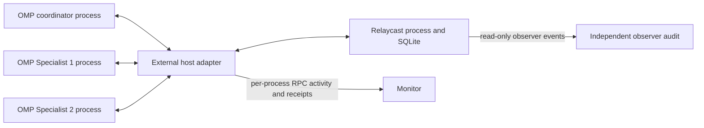

# Independent OMP processes with external messaging

Date: 2026-09-26. **Result: Relaycast passed the requested round-trip test with three independent OMP processes.** The final run completed three trials, with 12 verified message hops, separate session histories, an independent observer feed, and clean process exits. It is the preferred candidate for the next integration experiment; this is not approval of a production runner or recovery contract.

## Selection

The test needs independently running agents, addressed peer messages, visible history, an external progress feed, and reliable evidence of receipt. It must avoid OMP's internal team bus and terminal text injection. Existing provider/model configuration is reused only for the bounded message experiment.

| Rank | Approach | Reason and disposition |
| --- | --- | --- |
| 1 | Local Relaycast mailbox plus one OMP RPC connection per agent | Reuses addressed DMs, durable pending deliveries, explicit acknowledgements, and a separate observer API. Tested successfully after correcting two adapter/protocol issues. |
| 2 | Small standalone SQLite mailbox plus the same OMP RPC connections | Keeps the local experiment simple and the protocol under our control, but makes queue, receipt, observer, and recovery behavior ours to implement. Fallback prepared as a design; not implemented or run because the first candidate passed. |
| 3 | Standalone Agent Mail plus OMP adapters | Existing agent inbox and event/history mechanisms merit evaluation if the first two cannot meet the broader contract. Its exact version and API semantics still need adapter tests. Not run. |

NTM is an orchestration/terminal candidate, not the selected mailbox for this test. Email and network IRC add more adaptation for these local delivery and receipt requirements. Their prior [comparison](agent-communication-assessment.md) remains available. No claim is made that untested candidates are slower or less reliable in practice.

## Tested arrangement



All agents used the installed OMP **18.3.1** executable and `aperture-openai/openai.gpt-6-sol`. Each was launched separately with its own process group, session directory, and conversation. Only the external `send_message(to, body)` host tool was exposed. Native task creation, file/shell tools, and OMP team messaging were unavailable in the experiment.

The host binds each calling process to its own mailbox token; the model cannot supply a sender identity. A real model tool call causes a Relaycast DM write. The adapter reads the recipient's durable queue and delivers that exact stored envelope through the recipient's RPC prompt interface once it is idle. It acknowledges the mailbox item only after observing the envelope in that recipient's message event. This is a receipt boundary, not a claim that the requested work is complete. The next actual agent response proves that the message was used for this protocol.

The adapter transports agent-authored content; it does not generate START, FORWARD, or acknowledgement replies on behalf of the models. OMP's RPC host-tool interface is distinct from its native inter-agent bus. [Version-matched host-tool implementation](https://github.com/can1357/oh-my-pi/blob/6204b7508014bcdf12d95f0b3fd470905fd99344/packages/coding-agent/src/modes/rpc/host-tools.ts)

An observer token with `stream:read` and `dms:read` sees the message history without advancing recipients' queues. Process activity is captured independently from each OMP stdout RPC stream. A loopback monitor displayed PIDs, session identities, activity, and receipts. The [saved monitor](evidence/omp-external-roundtrip-2026-09-26.html) is a completed-run snapshot, not a currently executing team. [Mailbox preparation and API sources](external-mailbox-preparation.md)

The prototype monitor renders adapter-observed activity and storage/session receipts; the separate read-only mailbox feed was audited independently. The saved monitor was also opened in the browser and visually checked for all three process panels and the 12 receipt rows. This is a diagnostic fixture, not Crewroom's application UI.

## Results and evidence

| Agent | OS PID / process group | OMP session |
| --- | --- | --- |
| Coordinator | 95672 | `01a0dc3d-f9e8-71a8-9811-8bbea42eb085` |
| Specialist 1 | 95673 | `01a0dc3d-fb2b-7385-93bf-b997bb5efe8b` |
| Specialist 2 | 95674 | `01a0dc3d-fc74-76bd-83a1-36aa3586dabc` |

Each trial followed coordinator → Specialist 1 → Specialist 2 → Specialist 1 → coordinator. The three fresh markers completed in **3.63, 4.48, and 3.76 seconds**, measured from the RUN prompt through the final acknowledgement and settled turns, excluding startup. These are observations from a small test, not a performance benchmark.

The [sanitized evidence](evidence/omp-external-roundtrip-2026-09-26.json) and [independent evidence review](external-roundtrip-review.md) establish:

- 12 actual model-generated tool sends, matching successful tool results, stored DMs, and recipient transcripts.
- 12 matching events visible to the separate observer and 12 mailbox acknowledgements; no pending delivery remained in the final workspace.
- Specialist 2 first learned each marker from Specialist 1's incoming message. The coordinator's final acknowledgement followed Specialist 1's received relay.
- Separate process/session identities, no native-team activity or hidden task agents, and clean exits for all three OMP processes.
- No exhausted provider retries in the final run.

Raw evidence remains under ignored `.crewroom/experiments/external-roundtrip-3/`. The public evidence includes hashes of the raw transcripts and mailbox records. Private provider configuration copies were removed on shutdown; mailbox tokens remain server-side in the private experiment directory. No Jira, PR, the pilot repository, or live infrastructure changes occurred.

## Failed and qualified attempts

The first integration attempt completed one recorded round trip but then hit a **300 requests/minute** rate limit because the adapter polled idle recipients every 50 ms. The fix was a send-triggered mailbox check plus a two-second idle reconciliation interval. Messages still come from the durable queue; the send event is only a wake-up hint.

The second attempt delivered all 12 messages, but an independent review found **seven exhausted retry sequences** after empty assistant final responses. The harness's completion flag alone had missed them. This attempt is accepted as transport evidence only. The final protocol requires a nonempty `SENT` final response after each successful send, and the harness now fails if OMP exhausts automatic retries. The third attempt passed with those corrections. These were bounded fixes to our adapter and agent protocol; a continuing transport or observation failure would have triggered the next candidate.

## Reproduce

The server package is pinned to `@relaycast/engine@8.13.0`, installed only in the ignored experiment runtime. The [server wrapper](../../scripts/serve-relaycast-probe.mjs) is the exact loopback REST wrapper used in the test. It deliberately serves the REST API only; this experiment does not validate WebSocket reconnection. The preparation report records package integrity and the Node/native-SQLite version constraint.

From the repository root, prepare the disposable runtime with the same Node 22 installation used for its native dependency:

```sh
PATH=/Users/crewroom/.local/share/mise/installs/node/22.22.3/bin:$PATH npm install \
  --prefix .crewroom/experiments/external-mailbox-prep/runtime --save-exact @relaycast/engine@8.13.0
cp scripts/serve-relaycast-probe.mjs .crewroom/experiments/external-mailbox-prep/runtime/serve-loopback.mjs
cd .crewroom/experiments/external-mailbox-prep/runtime
/Users/crewroom/.local/share/mise/installs/node/22.22.3/bin/node serve-loopback.mjs
```

In another terminal at the repository root, use a new output directory:

```sh
python3 scripts/probe-omp-external-messages.py \
  --relay-url http://127.0.0.1:18787 \
  --model aperture-openai/openai.gpt-6-sol \
  --output .crewroom/experiments/external-roundtrip-next --rounds 3
```

The probe prints the temporary monitor URL. It stops its OMP processes and monitor at completion; stop the mailbox server with Ctrl-C. Crewroom's application runtime and package dependencies remain unchanged.

## Remaining contracts

This test establishes live addressed communication and external observation across independent OMP processes. It does not test killing/replacing a specialist, mailbox/controller restart, duplicate suppression after a lost send response, busy-agent steering, durable pause enforcement, or repository work.

Relaycast's ordinary local send idempotency is memory-backed in the inspected Node runtime, so a retained message alone is insufficient protection against a retry after restart. The default pending-delivery expiry also needs an explicit policy before adoption. Crewroom still needs durable logical message identities, recorded delivery uncertainty, process ownership, and recovery reconciliation. The next experiment should interrupt a specialist around receipt and prove safe replacement with this same external boundary.
