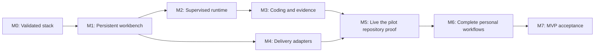

# Crewroom build plan: current scaffold to MVP

**Current development track, updated 2026-10-14:** [MH1–MH6](multi-harness-plan.md) are implemented and validated within the [recorded limits](testing/mh6-pair-2026-10-13.json): model catalog, Codex/Claude Code adapters, plan-aware intake and programming pairs alongside OMP. [S9.1 / FOR-12](testing/feature-map/README.md) is implemented and validated within its [recipe evidence](testing/for-12-feature-map-2026-10-13.json). [S9.2 / FOR-13](testing/corrections/README.md) is implemented and validated within its [correction/mutation evidence](testing/for-13-corrections-2026-10-13.json); [S9.3 / FOR-14](testing/for-14-implementation-plan.md) is implemented and validated within its [comparison, recovery and restore evidence](testing/for-14-comparison-2026-10-14.json). Existing release runtime and quality contracts remain prerequisites for subsequent changes.

**Accepted foundation and retained follow-up, updated 2026-10-14:** M0–M7, the required [native migration stages N1–N7](native-migration.md#ordered-migration-and-acceptance), and [M8 S1–S8](workbench-redesign.md) are accepted within their recorded scope. S9 retains the operator-approved verification and evaluated-learning work after the MH track; S9.1–S9.3 are accepted within their recorded bounds. [Status](status.md#continuation-order) records the next item and outstanding platform gates. The original acceptance cases below remain contracts; later work does not replace M7 delivery or recovery evidence.

Prepared 2026-09-27 from the [approved product direction](product.md), [selected architecture](architecture.md), and recorded experiments. This is the execution plan for that scope, not a new product proposal. Milestone completion requires linked evidence; selecting a technology or writing a test specification does not complete its application integration.

## Destination

**First live proof:** take one operator-selected the pilot repository Jira ticket through a reviewable Bitbucket PR, with visible independent agents, coordinator steering, interruption recovery, current Jira updates, and checks/review tied to the PR revision. Leave merge to the operator.

**MVP:** make that path repeatable through the local browser workbench, including the already accepted personal workflow: optional Explore/Grill, custom roles and specialist insertion, explicit repository selection, pause/resume/cancel, queue/dependency rules, Jira outage handling, branch drift, and operator-initiated PR feedback work. Support repository-based research/design outcomes without manufacturing a PR or coding evidence.

The first live proof is an early delivery checkpoint. It must satisfy the architecture's first-milestone acceptance cases; completing every configuration screen or less common workflow is not a prerequisite to beginning that proof. The remaining accepted workflows are still required before declaring MVP complete.

## Historical starting point (2026-09-27)

| Area | Actual state | Consequence for this plan |
| --- | --- | --- |
| Product and architecture | Approved; OMP 18.3.1, tmux 3.7c, Rust Agent Mail v0.3.36 selected | Integrate this stack; do not reopen the comparison without a new failing requirement |
| Application | React/TypeScript/Vite/Express scaffold; `server/index.ts` and `src/main.tsx` absent | No runnable workbench, production runtime, or browser acceptance yet |
| Domain code | Jira JSON validation/extraction, sample data, role read/update, initial shared types | Extend the model and persistence; these are not live Jira synchronization or complete role management |
| Existing checks | 14 scaffold passes; 13 retained-mechanism passes; 950 OMP identity bindings and 57 scripted profile turns | Preserve useful coverage without counting it as complete workflow acceptance |
| Selected runtime | 9 Rust Mail checks and 5 real OMP/tmux checks passed, including finite-retention characterization | Reuse the API/control contracts and fixtures; production adapters remain to be implemented |
| Full product tests | 87 specified cases and 12 specified jobs; earlier execution recorded 30 partial cases and 57 blocked cases, with all 12 complete jobs blocked | Add tests as real services become available; no end-to-end application pass is currently established |
| Provider onboarding | the pilot repository selected; Jira source/ticket, live role models, current Bitbucket policy/access, and isolated check environment still need confirmation | Inspect and collect these inputs while local implementation proceeds |
| Source control | No commits or remote; scaffold and documentation untracked | Preserve current files and create a reviewable baseline during the first implementation milestone |

Evidence: [handoff](../HANDOFF.md), [initial execution report](testing/results-2026-09-26.md), [Rust Mail/tmux report](testing/rust-mail-results-2026-09-27.md). These are recorded results, not tests rerun while writing this plan.

## Scope boundaries

These boundaries describe the original M0–M7 release. The native workbench has since shipped within its recorded scope, and additional harness integrations are now the accepted [MH development track](multi-harness-plan.md). Use [current status](status.md#continuation-order) for today's continuation order.

Keep one operator, one machine, one repository per ticket, one executing coding ticket, up to three compatible specialists plus the coordinator, and one writer per worktree. Multiple repository configurations are supported; the pilot repository is the live pilot. User roles/models remain configurable. Inspection stays separate from steering through the coordinator.

Defer multi-user service operation, multi-machine agents, multi-repository tickets, automatic backlog selection, automatic repository mapping, live infrastructure changes, automatic merge/deployment, native desktop UI, and additional harness integrations. JEV/System 1 routing remains a later adviser, not a dependency for this MVP. A custom mailbox is considered only if existing services cannot meet a required contract. UI polish beyond clear, usable operator flows follows functional delivery.

Do not defer correctness: persistent inputs, truthful status, safe ownership, scope enforcement, model verification, independent review, current-revision evidence, and reconciliation of uncertain external writes are prerequisites for live delivery.

## Milestones and dependencies

| ID | Milestone | Status | Depends on | Exit result |
| --- | --- | --- | --- | --- |
| M0 | Runtime selection and bounded experiments | Complete within recorded scope | — | Selected stack and reproducible evidence |
| M1 | Runnable persistent workbench foundation | Complete — see execution record | M0 | A ticket and its local brief survive application restart |
| M2 | Supervised agent runtime | Complete — see execution record | M1 | Real independent agents communicate, stop safely, and recover under application control |
| M3 | Local coding workflow and evidence | Complete — see execution record | M2 | Disposable code change reaches review readiness through real application services |
| M4 | Jira and Bitbucket delivery adapters | Complete — see execution record | M1; integrate with M3 | Simulated delivery and lost-response recovery pass; live onboarding is verified |
| M5 | First live the pilot repository proof | Complete — see execution record | M2, M3, M4 and pilot inputs | One real ticket produces a PR, confirmed Jira updates, and revision-bound evidence |
| M6 | Complete accepted personal workflows | Complete — all slices and M7 coverage accepted | M3, M4; finish after M5 feedback | Refinement, queueing, drift, feedback continuation, and research outcomes work end to end |
| M7 | MVP release and repeatability | Complete — [release accepted 2026-10-02](release-0.1.0.md) | M5, M6 | Reproducible startup, complete acceptance evidence, recovery guidance, and usable workbench |

The critical path is persistence → reliable runtime → coding/evidence → live delivery. Provider inspection and adapter implementation can proceed alongside runtime work once shared identities and action records are defined. M6 components can start sooner where their dependencies exist, but must not postpone the first live proof for screen completeness. No calendar estimate is claimed until the child-tool and surviving-writer risks in M2 are resolved.

## M1 — Runnable persistent workbench foundation

**Deliver:** the smallest browser application that can retain work and explain its current state.

- [x] **M1.1 — Preserve and organize the baseline.** Capture the existing source/docs/lockfile in a versioned checkpoint without removing user work. Keep ignored test artifacts and credentials outside version control. Review the [retired mechanism assessment](research/omp-team-reuse-assessment.md); decide which ownership/evidence/reconciliation rules to port and which bounded helpers to reuse. Keep the retired installation inactive and a single authority for workflow state.
- [x] **M1.2 — Implement transactional storage.** Add schema/migrations and operations for repository configuration, site-aware ticket identity, imported fields, independent refinements, accepted brief revisions, runs, assignments, attempts, steering, observations, evidence references, and pending external actions. Introduce records as their first operations are implemented; do not create a separate simulated workflow engine.
- [x] **M1.3 — Make the application runnable.** Add the missing server/frontend entry points and one loopback origin for UI/API. Enforce host/origin checks on mutations; keep credentials server-side. Provide ticket selection, a minimal ticket workspace, saved brief/criteria, and distinct Jira/workflow/agent status displays. Unavailable integrations remain labeled unavailable.
- [x] **M1.4 — Establish application checks.** Preserve the scaffold regressions and add persistence/reopen, import/refinement, duplicate admission, and origin-boundary tests. Wire Playwright to the actual local server.

**Exit gate:** create/import a fixture ticket, edit its local brief, refresh its imported fields, restart the application, and recover the correct source/local values through the UI. `npm test`, `npm run build`, and the relevant `npm run test:e2e` journey pass. The missing-entry-point build failure is resolved. A queued run is visibly awaiting execution until M2 supplies a runner.

**Execution order:** The operator requested sequential completion and testing of each item. Finish M1.1, then storage (M1.2), then API/UI (M1.3), then the restart journey (M1.4). Do not build a complete disconnected dashboard before moving to M2.

## M2 — Supervised agent runtime

**Deliver:** application-owned OMP hosts, Rust Mail integration, and truthful execution controls.

- [x] **M2.1 — Validate assignments before launch.** Resolve role/model defaults explicitly, apply project constraints, validate capability/effort settings, and read back actual OMP identity. Reject mismatches or apply only an explicit configured fallback. Cover secondary model paths so auxiliary work cannot silently bypass assignment policy.
- [x] **M2.2 — Integrate hosts and messages.** Launch one OMP process through each tmux host, capture structured progress outside the agent, and connect the tested HTTP MCP adapter. Persist logical message/action IDs and transport mappings, bind senders to admitted attempts, enforce recipient scope, preserve causal replies, and keep observer cursors independent. Handle retry-key expiry through reconciliation. Keep Rust Mail's ATC disabled and credentials in the backend.
- [x] **M2.3 — Prove safe interruption early.** Run a real disposable shell/tool child, pause it, and establish when both OMP work and descendants stopped. Exercise host exit, dedicated tmux-server failure, supervisor restart, stale process identity, and surviving workers. Do not launch a replacement writer until old ownership is resolved. This is a go/no-go gate for coding admission, not work to postpone until release.
- [x] **M2.4 — Implement continuity and limits.** Resume usable sessions or create recorded replacement attempts from durable inputs/checkpoints. Preserve steering disposition and uncertain effects. Enforce two automatic repair/replacement cycles, durable active-time accounting with the initial 60-minute limit, and pause/resume/cancel semantics. A UI disconnect must not lose control or reset budgets.
- [x] **M2.5 — Expose supervision.** Show each process/session, assignment, requested/resolved model, activity, peer messages, failure, and recovery state. Add the coordinator conversation and pause/resume/cancel controls; recover observations after browser reconnect. Implement read-only observation access through Crewroom.

**Exit gate:** a three-process exchange runs through the application adapters with heterogeneous scripted providers. Kill a specialist and restart the supervisor at defined receive/dispatch boundaries; recover saved input once with no competing owner. Pause during a child tool, retain queued steering without execution, then resume. The 14 existing mailbox/tmux checks remain regression evidence; new application tests establish the production integration they do not cover.

If descendant termination or ownership cannot be established, keep the run in pausing/attention-required state and resolve that boundary before M3. Investigate an adapter fix first; do not hide the failure behind terminal inactivity or weaken the gate.

## M3 — Local coding workflow and revision evidence

**Deliver:** a complete coding job against a disposable repository using the real workflow service.

- [x] **M3.1 — Coordinate assignments.** Let the coordinator propose a minimal or complex team; validate proposals in the workflow service. Add coordinator and delivery-reporter roles alongside the scaffold catalog. Support creating/editing user roles, immutable assignment snapshots, and specialist insertion at a safe point. Keep delivery reporting and repository documentation responsibilities distinct.
- [x] **M3.2 — Own repository work.** Create an isolated branch/worktree from the selected target; preserve the operator checkout. Enforce one coding ticket and one writer per worktree, with up to three compatible specialists. Support explicitly selected continuation of an existing branch/PR only after ownership checks. Record interrupted edits/commits and detect changed base/head/requirements.
- [x] **M3.3 — Execute and verify.** Implement the assignment → edit → actual repository checks → independent review → bounded rework cycle. Review is performed by an agent that did not implement the candidate. Store check environment, command result, output/artifact hashes, producing attempt, criteria coverage, and exact base/head/tree identity. Missing, failed, skipped-required, stale, or forged evidence cannot produce readiness.
- [x] **M3.4 — Present the result.** Add the change/evidence view, review findings, blocker explanations, and available usage/cost with clear provenance. Show publication as unavailable until M4, while allowing local validation to complete.

**Exit gate:** E2E-01's local portion and E2E-03 run against the actual application with real Git changes and commands. Deliberately fail a check and an independent review, repair them within the bound, and certify only the resulting revision. Exercise steering/insertion and interruption during this coding flow. Scripted reviewer outputs validate orchestration; M5 supplies live review evidence.

## M4 — Jira and Bitbucket delivery adapters

**Deliver:** real provider boundaries with durable action reconciliation and controlled offline tests.

- [x] **M4.1 — Onboard read-only.** Confirm the Jira source, intended issue/repository mapping, permitted transitions, and current Bitbucket access/reviewer/check policy. Confirm the pilot repository's branch/rebase/runtime instructions and isolated database/browser test requirements. Save configuration and capability observations without importing credentials into browser state or logs.
- [x] **M4.2 — Import and synchronize Jira.** Read selected tickets through the chosen API/MCP adapter; preserve source ordering and independent local refinements. Run only explicitly queued work. Let the delivery reporter produce allowed status, milestone/blocker, and evidence-link updates. Description/criteria rewrites require the existing explicit operator instruction. Queue writes during outages; reconcile refreshed requirement conflicts. [Validation](testing/jira-sync-2026-09-28.json): conflicts stop affected processes and retain both versions; scope acceptance/continuation is the M6.3 extension, and published PR/evidence links follow in M4.3.
- [x] **M4.3 — Publish and observe PRs.** Persist push/PR/Jira intents before execution and reconcile existing, confirmed-absent, and unknown outcomes after a lost response. Create accurate PR content and observe exact check identities/revisions. the pilot repository PR creation can precede hosted validation; PR-created/validation-pending is separate from ready-for-review. Keep merge outside automatic execution.
- [x] **M4.4 — Finish the synthetic delivery path.** Connect fake Jira/Bitbucket boundaries to the same application services used by live adapters. Exercise permission errors, outages, stale events, and lost create/comment replies. Do not fork the workflow into a second test-only implementation.

**Exit gate:** E2E-01, E2E-06, and delivery error cases complete with real local code/evidence and simulated providers. Unknown writes remain uncertain; confirmed existing PRs/updates are adopted without duplicates. Read-only live onboarding is complete before M5 begins.

## Design review remediation

The operator requested on 2026-09-28 that every finding in the [design review](design-review-2026-09-28.md) be worked through. These items precede resuming M5.3. U1 and R4 come first; R3 follows R4 because the live wall depends on its store changes. Work them in the order below; each shares the store or supervisor with its neighbours, so they are sequential. Each exits with `npm test` and `npm run build` passing, `npm run test:e2e` for changed user flows, a focused real-process check for process-boundary changes, and an entry in [the progress record](testing/mvp-progress.md).

- [x] **R1 — Supervision under observation load.** A live, identity-matching host that times out is degraded observation and charges no recovery cycle; incremental cursor-based event observation; snapshots without full event history; revision-keyed asynchronous repository status. Regression: multiple and slow observers leave a running run executing with unchanged counters. [Executed checks](testing/mvp-progress.md#r1--supervision-under-observation-load).
- [x] **U1 — Status truthfulness and edit safety (before resuming M5.3).** Label interrupted or incomplete checks as such, not Failed; keep unsaved brief edits when opening panels or switching tickets; show exhausted automatic cycles on the agent and add an explicit, recorded operator control to allow another repair cycle (operator Resume stays available and never consumes a cycle); confirm Cancel. [Executed checks](testing/mvp-progress.md#u1-r4-and-the-r3-live-agent-wall--2026-09-28).
- [x] **R4 — Store structure.** Pure table-tested run lifecycle module; indexed state columns with a migration verified on a copy of the pilot database; event retention that keeps receipts at full fidelity. [Executed checks](testing/mvp-progress.md#r4--pilot-copy-migration-check).
- [x] **R3 — Event-driven supervision and live agent wall ([ADR 0007](adr/0007-live-agent-wall-over-push-channel.md)).** Per-host observation from tmux control mode and RPC streams, explicit per-run transition serialization, no busy-waits or synchronous child-process calls on the supervision path. The same streams feed a WebSocket push channel with cursor resume, replacing all browser polling. Run view shows one `ghostty-web` tile per admitted assignment and running check, with proposed specialists as placeholders and retired attempts collapsed; tiles are read-only. Host writes a formatted live stream to its pane; checks run in their own windows; terminal output goes to bounded per-attempt logs. Spike first: `ghostty-web` vs xterm.js, native OMP TUI alongside RPC. Regression: viewer detach/reconnect, slow viewer, long-running check, four agents, intentional interruption, all with unchanged recovery counters. [Executed checks](testing/mvp-progress.md#r3--event-driven-supervision-2026-09-28). *The native-TUI spike is negative: RPC mode cannot share a TUI, so panes keep the formatted RPC stream. Agent tool handlers and operator routes now use asynchronous Git, with an observer-responsiveness regression (2026-09-29).* *Reopened 2026-09-29 for a refinement landing during an asynchronous Git probe, which could let evidence, publication and Jira gates accept superseded criteria. The repair's integrated gates and independent review have since passed ([record](testing/mvp-progress.md#r3-repair-requirements-read-after-asynchronous-git-2026-09-29)).*
- [x] **R7 — Per-run ownership.** Per-run ownership checks with the one-executing-coding-ticket rule as explicit policy; allocated host ports; a single `authorizeHost`. [Executed checks](testing/mvp-progress.md#r7--per-run-ownership-2026-09-29).
- [x] **R5 — Actual usage.** Per-attempt token usage from provider responses, labeled actual or unavailable, shown in the workbench. [Executed checks](testing/mvp-progress.md#r5--actual-usage-2026-09-29).
- [x] **R6 — Structured briefs.** Criteria, per-criterion obligations/checks and assignment dependencies snapshotted at admission and presented to specialists and reviewers. [Executed checks](testing/mvp-progress.md#r6--structured-briefs-2026-09-29).
- [x] **R2 — Specialist tools.** Worktree search and bounded partial edits under writer/hash rules; ADR and real-runner contract test for contained full-harness execution. [ADR 0008](adr/0008-contained-specialist-tools.md) adopts search, exact-span edits and a contained read-only shell, and defers the native harness in a container until a Linux OMP build is admitted. [Executed checks](testing/mvp-progress.md#r2--specialist-tools-2026-09-29).
- [x] **R8 — Learning proposals.** Coordinator-proposed, operator-approved, versioned role/project-instruction updates that never alter historical assignments or validation policy. [Executed checks](testing/mvp-progress.md#r8--learning-proposals-2026-09-29).
- [x] **R9 — Documentation consolidation.** Single current-status source, short handoff, archived superseded research with working links. [Executed checks](testing/mvp-progress.md#r9--documentation-consolidation-2026-09-29).

## M5 — First live the pilot repository proof

**Deliver:** the first useful outcome promised by the product direction.

- [x] **M5.1 — Select the pilot.** Use a small representative Jira ticket explicitly assigned to the pilot repository by the operator, with testable criteria. Confirm live role/model assignments and an isolated environment for its required checks. Prefer a ticket that exercises coding, review, and documentation without infrastructure changes.
- [x] **M5.2 — Execute through the workbench.** Import, accept the brief, and queue the ticket. Demonstrate selected specialists, coordinator steering, insertion where useful, actual progress, pause/resume, and one controlled interruption/recovery while preserving the work. [Live evidence](testing/live-execution-2026-09-28.json).
- [x] **M5.3 — Deliver and inspect.** Create the real Bitbucket PR; observe required local/hosted checks and independent review for its exact revision. Confirm Jira status/comments/evidence links. Present remaining limitations and leave the human merge decision to the operator. Private delivery evidence is retained in the pre-rewrite archive.

**Status:** M5 is complete. The live proof exposed several gaps: target drift, check memory, continuation size, context overflow, the Bitbucket API contract, reviewer-facing PR descriptions, and post-merge Jira. Each was repaired with regressions and independent review; see the progress record. The operator's Jira policy is now implemented: *Review* when the PR is created, *Close* after a verified merge.

**Exit gate:** every [first-milestone acceptance case](architecture.md#first-milestone-acceptance-cases) has an evidence record for the pilot. Controlled provider-fault tests remain labeled simulated; live claims identify actual ticket, provider identities, revisions, and results. A PR with pending/failed/unavailable required evidence does not complete this gate.

## M6 — Complete accepted personal workflows

**Deliver:** the rest of the agreed MVP behavior, incorporating findings from the live proof.

- [x] **M6.1 — Conversational refinement and non-coding work.** Implement optional Explore and Grill through the coordinator, persist decisions and brief revisions, and allow direct Run. Complete standalone research/design/documentation outcomes with source/artifact evidence appropriate to the task. *Complete ([record](testing/mvp-progress.md#m61--accepted-2026-09-29)).*
- [x] **M6.2 — Queue and repository configuration.** Complete multiple repository configurations with explicit selection, independent local queue ordering, repeat-control handling, and restart-safe scheduling. Start the next independent ticket after review readiness; hold dependent work until verified merge. Keep one executing coding ticket. *Complete ([record](testing/mvp-progress.md#m62--accepted-2026-09-30)).*
- [x] **M6.3 — Drift and review continuation.** Invalidate readiness on confirmed target/requirements changes or newly failing checks. Refresh the owned branch according to project rebase policy, reconcile conflicts within scope, and rerun affected evidence. Surface PR feedback and resume it only after the operator selects Resume on the existing branch/PR. *Complete: [Slice 1](testing/mvp-progress.md#m63-slice-1--confirmed-readiness-re-hold-and-queued-resume-2026-09-30) (confirmed readiness re-hold and durable queued Resume), [Slice 2](testing/mvp-progress.md#m63-slice-2--crash-safe-target-conflict-recovery-2026-10-01) (agent conflict reconciliation) and [Slice 3](testing/mvp-progress.md#m63-slice-3--pr-feedback-continuation-accepted-2026-10-01) (PR-feedback continuation). Provider outages or unreadable evidence alone do not re-hold the slot, though they still block a ready claim.*
- [x] **M6.4 — Complete operator flows.** Finish role/model/repository editing, steering and insertion feedback, failure explanations, usage provenance, cancel/later-continuation, and history navigation. Cover basic keyboard access and usable layouts. Do not add a separate direct-specialist steering workflow. *Complete: [Slice F acceptance](testing/mvp-progress.md#m64-slice-f--cancel-and-later-continuation-accepted-2026-10-01) closes the final operator-flow slice.*

**Exit gate:** all 12 synthetic scenarios execute against real application services with external-boundary fixtures, including complex team selection, research-only work, queued dependencies, drift, untrusted content, and budget exhaustion. Applicable Playwright journeys exercise the same services and verify truthful status. Live follow-up uses operator-queued work within the established scope.

### M6.3 Slice 3 — PR-feedback continuation

**Accepted 2026-10-01** at implementation commit `ad4c44a`; see the [acceptance record](testing/mvp-progress.md#m63-slice-3--pr-feedback-continuation-accepted-2026-10-01). Baseline: accepted Slice 1 `1153f8a`, Slice 2 `38b62b0`, and acceptance record `dec01c7`. This section remains the scope record.

**One outcome:** the operator sees feedback for an existing open PR, selects the existing Resume control, and receives a newly validated revision on the same owned branch and PR, with prior work and evidence retained.

**Included work:** read and display provider feedback associated with the current ticket/PR; persist enough identity and observation state to replay it truthfully; carry the feedback into the coordinator's explicit continuation; admit a feedback-derived candidate through the existing evidence/publication gates. Keep current Resume, coding-slot, ownership, and delivery mechanisms. Comments are untrusted task material within the accepted brief, not instructions that expand agent authority or adopt new requirements.

**Boundary:** finish this single path. M6.4 editing/insertion/cancel/history redesign, new runner or supervisor mechanisms, automatic orphan termination, automatic comment-triggered execution, a new review conversation/composer, provider comment replies/resolution, webhooks, additional providers, merge automation, and general UI cleanup remain outside this slice. Target drift and uncertain Git ownership use the accepted Slice 2 behavior. A newly found defect in those invariants is explicitly triaged; it does not silently become another implementation phase.

Before editing, the coordinator records one compact slice brief: baseline, the existing mechanisms reused, owned paths, the feedback/Resume/publication identity decision, the acceptance cases below, unresolved questions, and one cumulative repair counter. Resolve a consequential identity or recovery uncertainty in one bounded investigation before coding. A new architecture dependency requires a checkpoint and explicit scope decision.

Acceptance is limited to these five behavior cases, linked to DEL-04/05/06 and applicable existing evidence:

1. **Observe:** provider feedback is visible with its PR association and source identity. Repeated observations do not duplicate it; unavailable or partial reads are distinguishable from no feedback. Observing comments starts no agents and performs no provider write.
2. **Resume:** one explicit request carries the captured feedback to the coordinator under the accepted brief, using the existing durable queue if another run holds the coding slot. Repeat requests and restart do not create a second logical continuation or writer. Preserve run, owned branch, and PR identity.
3. **Validate and update:** an actual feedback code change creates a new candidate, retains historical evidence, and requires checks and independent review for that revision before readiness. Publish it to the existing PR; a lost response cannot create another PR. A no-change outcome does not manufacture a commit or new passing evidence.
4. **Interrupt:** exercise the new continuation boundaries in the failure model. Replay confirmed work; retain an explained hold for uncertain ownership or delivery. Preserve cancellation and newer control intent through the existing lifecycle rules.
5. **Stay within scope:** late comments, stale provider observations, required-check failures, target/source drift, and a closed or merged PR cannot silently expand the captured assignment, revive stale evidence, overwrite an unexpected head, or authorize merge. Reuse existing tests for unchanged gates and add only missing continuation coverage.

**Execution and stop rules:**

- Confirm effective automatic worker routing and the configured coordinator before substantial OMP work. Keep one implementation owner and one retained opposite-vendor reviewer; resolve actual models from user configuration. Give difficult lifecycle work one owner from its bounded diagnosis through focused tests. The coordinator owns scope and acceptance.
- After **60 active minutes without a reviewable increment**, checkpoint the candidate, elapsed work, accepted cases, blocker, and next decision. After **two consolidated repair passes for this slice's acceptance outcome**, stop automatic repair and replan. Worker replacement, a renamed finding, or a new subproblem does not reset the count. Record provider waits separately. A check already running may finish; a failed checkpoint never counts as acceptance.
- The implementer owns focused regressions. Freeze the candidate for the retained reviewer's scoped review and one integrated verification owner. That owner runs `npm test`, `npm run build`, and `npm run test:e2e`, including the observe → Resume → same-PR update journey. Reuse still-applicable evidence after a fixture-only repair; rerun the checks the change invalidates. Tests target these cases and real defects, not speculative failure combinations or cosmetic fixture cleanup.
- Verify with disposable local Git/provider fixtures and the existing application/runtime harness. Label simulated boundaries. Existing recovery coverage is reused unless changed behavior invalidates it; acceptance does not require a new supervisor, a full unrelated process sweep, or live changes to the retained pilot.
- Finish with exact-candidate review/test evidence, a progress entry, and a commit before any next slice. Report accepted, incomplete, or blocked against these cases and stop at the slice boundary. M6.4 begins only after the remaining M6.3 obligations are accepted and the user directs continuation.

### M6.4 — Complete operator flows

**Baseline:** `d22824c` (M6.3 accepted). Slices are taken in order A → F; each is accepted and committed before the next starts. The [gap inventory](m64-execution-and-model-review-2026-10-01.md#proposed-m64-slices) found that role/model editing, run-history selection, usage labels, steering states, coordinator insertion proposals and Cancel already exist; slices finish the gaps rather than rebuild them. Keyboard access and usable narrow layouts are part of each affected slice.

**Operator decisions (2026-10-01):**

- **Repositories (B):** guarded edit and retire. All fields are editable with revalidation; checkout path and target branch changes are refused while queued or active work references the configuration. Delete retires: hidden from new selection, retained for history, refused while queued or active work references it.
- **Insertion (E):** a direct operator form (role, input, dependencies) stores an operator-originated proposal that the existing transactional proposal path applies at the next safe coordination point; the coordinator is notified. Insertion alone does not invalidate evidence; readiness waits for the new assignment, and a changed revision invalidates through the existing gates.
- **Later continuation (F):** Cancel stays terminal. *Continue later* queues a linked successor run on the cancelled run's branch and PR through the existing continue-branch launch mode and ownership check; history shows the chain.
- **Queued plans (A):** admission resolves the role definitions current at admission, as `LaunchSpec` already documents; a queued plan is not an assignment.

**Execution rules:** the M6.3 Slice 3 execution and stop rules apply per slice: one implementation owner, one retained opposite-vendor reviewer, two consolidated repair passes per slice outcome, 60-minute reviewable-increment checkpoint, `npm test` / `npm run build` / `npm run test:e2e` on the frozen candidate, a progress entry and a commit.

#### Slice A — Role and model editing

**Accepted 2026-10-01**; see the [acceptance record](testing/mvp-progress.md#m64-slice-a--role-and-model-editing-accepted-2026-10-01).

**Outcome:** role and model edits persist without lost updates, and every assignment visibly keeps the role revision and model it was admitted with ([ROL-02](testing/suite.json), [ROL-03](testing/suite.json)).

**Reused:** `RoleCatalog` revisions and atomic save (`server/roles.ts`), role snapshot on `Assignment.role`/`model` (`server/workbench.ts` `admitAssignmentInTransaction`), `RoleEditor` (`src/roles.tsx`), learning-proposal role updates, model preflight at launch.

**Failure model:** two writers (two tabs, or an editor and a learning approval) save from the same revision — the later save must be refused, not silently overwrite. A crash mid-save leaves the previous file (atomic rename, existing). A stale editor draft is never discarded without the operator's choice. A role edit never changes an admitted assignment's role, model, effort or instructions; a queued unadmitted plan picks up the current definition at admission. Disabled roles cannot receive new assignments.

**Acceptance cases:**

1. **Persist:** create and edit a role's instructions, model selector and effort; after reload the editor shows the saved values and the current revision (and learning provenance when present).
2. **Conflict:** a save carrying a stale revision is refused with an explained conflict; the draft is retained and the operator can reload the current definition. The learning-approval path still saves correctly.
3. **Snapshot:** after an assignment is admitted at revision N, editing the role to N+1 with a different model and instructions leaves the stored assignment and its wall display at revision N with the original model; the wall states when the current definition differs. A later admission uses N+1.
4. **Disable:** a disabled role is not offered for new assignments and is refused server-side; existing assignments are unaffected.
5. **Keyboard/layout:** the editor and the assignment detail are operable by keyboard with labelled controls and no horizontal overflow at 390 px.

**Repair counter:** 0.

#### Slice B — Repository editing

**Accepted 2026-10-01** at `9d417a7`; see the [acceptance record](testing/mvp-progress.md#m64-slice-b--repository-editing-accepted-2026-10-01).

**Outcome:** the operator can edit and retire repository configurations; edits revalidate through the existing Git preflight, and queued work, open runs and historical references stay coherent (REP-01, REP-02 configuration aspects).

**Reused:** `validateRepository` Git preflight (`server/repository-configuration.ts`), `saveRepository` duplicate/replay rules, `RepositoryWorkRecord.repository` snapshot taken at preparation, `runHold` "Selected repository unavailable", `assignRepository` open-run guard, the Repositories panel (`src/main.tsx`).

**Failure model:** a queued run resolves its repository configuration at preparation; a prepared run owns its snapshot. Two editors saving from the same configuration revision — the later save is refused. An edit racing scheduler admission — the reference guard and the update run in the same store transaction as admission reads, so a path/target change can never land between a queued run's guard check and its preparation. Git preflight runs before the transaction and is repeated if the guard admits the edit. Removing or renaming a check ID that a queued launch brief references is refused. A retired configuration is never deleted from the store.

**Acceptance cases:**

1. **Edit:** name, branch prefix and checks edits revalidate and persist across store reopen; keyed requests replay; duplicate path + target refusal applies to edits; a stale revision is refused with the draft kept.
2. **Guard:** a path or target branch change, or removal of a check referenced by a queued launch brief, is refused while a queued or open run references the configuration, naming the referencing tickets; the same change succeeds when only terminal runs reference it.
3. **Coherence:** a prepared run's repository snapshot (path, target, prefix, checks) is unchanged by later edits; a queued run prepared after a permitted edit uses the edited configuration; Results and run history still show the original repository details.
4. **Retire:** retiring hides the configuration from new ticket selection and queueing, is refused while queued or open work references it, and leaves historical runs readable; a ticket that still selects it shows it as retired and requires reselection before Run.
5. **Keyboard/layout:** edit and retire controls are labelled, keyboard-operable, confirm retirement, and fit 390 px.

**Repair counter:** 1/2. The four initial review findings were repaired before the interruption; the retained reviewer cleared the resumed recheck. See the [progress record](testing/mvp-progress.md#m64-slice-b--repository-editing-accepted-2026-10-01) for integrated verification.

#### Slice C — Failure, usage and history views

**Accepted 2026-10-01** at `dad3938`, under the documented timing-test exception; see the [acceptance record](testing/mvp-progress.md#m64-slice-c--failure-usage-and-history-views-accepted-2026-10-01).

**Outcome:** the operator can see why work failed or stopped, where every usage figure came from, and navigate earlier runs and attempts without losing their place.

**Reused:** recorded failure signals and run `attentionReason` (`server/workbench.ts`), wall event text (`src/wall.tsx` `eventText`), provider usage receipts (`server/runtime/provider-usage.ts`), Results aggregation (`server/results.ts`, `src/results.tsx`), the Run history selector (`src/main.tsx` `Ticket`).

**Failure model:** a cause that was not recorded is shown as unknown, never inferred. An unavailable observation is distinguished from an agent failure and from the saved controller error (`Observation.error`). Unavailable usage is never shown as zero or as billed cost; partial usage says which attempts lack receipts. A deep link to a missing or foreign run falls back to the ticket's default run with a notice.

**Acceptance cases:**

1. **Explain:** each failed, stopped or needs-attention attempt and each held or needs-attention run shows its recorded cause (exit code or signal, turn error, model-policy rejection, ownership reason, launch or preparation hold, active-time limit) and the next available operator action; a missing cause reads as unknown. An observation outage is labelled as such.
2. **Prior attempts:** a prior attempt can be opened read-only to show its cause, timing, usage and the evidence it produced.
3. **Usage provenance:** per-attempt and per-run usage show actual, partial or unavailable with their source; the wall and Results agree for the same run.
4. **History:** the selected run (and attempt) is addressable by URL, survives reload and browser Back, and history entries show purpose, status, start time and outcome.
5. **Keyboard/layout:** run tabs follow the tabs pattern (arrow keys, Home/End, roving focus); history and attempt navigation work by keyboard and fit 390 px.

**Repair counter:** 1/2. The retained reviewer accepted the four repaired presentation findings; build and all 23 browser tests pass. The full domain run is 290/291 with the known checked-reset intermittent; its unchanged focused rerun passes.

#### Slice D — Steering feedback

**Accepted 2026-10-01** at `daf5680`; see the [acceptance record](testing/mvp-progress.md#m64-slice-d--steering-feedback-accepted-2026-10-01).

**Outcome:** for every steering message the operator can tell whether it was only stored, delivered and received, applied to the plan, or rejected, and when; nothing is shown as further along than recorded.

**Reused:** the `steering` table and its pending → dispatched → received → applied/rejected transitions, the authenticated coordinator receipt, `CoordinatorPanel` labels and composer (`src/wall.tsx`). No direct-specialist steering is added.

**Failure model:** a receipt lost across a restart leaves the message dispatched and unconfirmed until reconciled; it is never re-dispatched as a second logical message. Application means reconciled into the plan or an explicit response, not finished work. A message stored on a paused run waits for Resume. A message still pending when its run is cancelled, closed or completed is marked not delivered rather than left looking queued. If completed research reopens through explicit requirements adoption, old undelivered messages remain historical; their bodies do not enter the continuation context.

**Acceptance cases:**

1. **States and times:** each message shows its current state with the time it was stored and the time of each later transition; applied says it was reconciled into the plan, not completed; rejected shows the coordinator's reason.
2. **Received, not applied:** a received message without a disposition stays received and not yet applied; coordinator reply text never implies application.
3. **Restart and pause:** after a restart, a dispatched message reconciles to its recorded receipt or stays unconfirmed, with one delivery per message key; a message sent while paused is delivered once after Resume.
4. **Terminal runs:** the composer explains why it is disabled; messages left undelivered by cancellation or closure say so.
5. **Keyboard/layout:** state is conveyed in text (not colour alone), the composer is keyboard-operable, and the conversation fits 390 px.

**Repair counter:** 1/2. The retained reviewer cleared the research-reopen repair. Final domain **296/296**, browser **25/25**, and build gates pass.

#### Slice E — Specialist insertion

**Outcome:** the operator can insert a specialist before or during a run; it becomes exactly one explicit assignment at a safe coordination point, and its effect on readiness and evidence is shown.

**Reused:** `team_proposals` and the transactional, idempotent proposal apply path (`server/workbench.ts`, `server/runtime/supervisor.ts` safe-stop transition), snapshot of role/model/brief at admission (Slice A), revision and rebrief gates (`server/evidence.ts`), the proposed-specialist tile.

**Failure model:** a repeated or replayed insertion request creates at most one proposal and one assignment. A restart between proposal and application resumes the same proposal. Insertion respects the three-specialist limit and the disabled-role rule and is refused with a reason otherwise. Insertion alone does not invalidate evidence; readiness waits for the inserted assignment, and a changed revision invalidates through the existing gates. Insertion on a cancelled or closed run is refused.

**Acceptance cases:**

1. **Insert:** an operator form (role, input, dependencies, optional criteria) stores an operator-originated proposal; the wall shows it as proposed and not started; the coordinator is notified through its conversation.
2. **Apply once:** at the next safe coordination point the proposal becomes one assignment with a snapshotted brief; replays, double submits and restart do not create a second.
3. **Readiness and evidence:** readiness waits for the inserted assignment; evidence for an unchanged revision stays current; a revision changed by the inserted specialist requires renewed checks and review.
4. **Refusals:** limit, disabled role, unknown dependency and terminal-run insertion are refused with an explanation and no partial record.
5. **Keyboard/layout:** the form is labelled, keyboard-operable and fits 390 px.

**Accepted 2026-10-01. Repair counter: 2/2, unchanged.** Implementation checkpoint `328c2f8` retains clear review, focused insertion evidence and two guarded process scenarios. The checked-reset gate was resolved by the bounded M7.2 fixture repair at `17c8165`: scoped Anthropic review is clear, build and browser **28/28** pass, and domain coverage combines **302/303** from the initial latch candidate with **1/1** on the repaired fixture, as permitted for fixture-only repairs. See the [explicit gate decision](testing/mvp-progress.md#m72--checked-reset-gate-decision-and-slice-e-acceptance-2026-10-01); no test skip or production ownership change was made.

#### Slice F — Cancel and later continuation

**Outcome:** Cancel ends execution and keeps work, evidence and PRs; the operator can later continue that work through a linked successor run on the same branch and PR without accidental restart.

**Reused:** `/cancel` and the terminal desired-state rule (`server/run-lifecycle.ts`), safe stop preserving attempts, the `LaunchSpec.repository` continue mode with expected-head ownership check, the publication record, the coding queue and slot, run history (Slice C).

**Failure model:** Cancel is terminal for its run; continuation never reopens it. The successor is created only by an explicit operator action, once per request key, and queues like any plan. Continuation requires the cancelled run's execution to be confirmed stopped and its branch head to match the recorded head; a moved head, uncertain ownership, a merged PR or a closed PR is held or refused with an explanation. Requirements adopted for the successor follow the existing adoption rules.

**Acceptance cases:**

1. **Cancel:** cancelling an executing run stops its agents, shows stopping until confirmed, and preserves worktree, attempts, evidence and the PR.
2. **Continue later:** *Continue later* on a cancelled coding run queues one successor linked to it, on the same branch and PR, with the expected-head check; repeated requests and restart create no second successor and never restart the cancelled run.
3. **Guards:** a moved head, uncertain ownership, or a merged or closed PR holds or refuses continuation with a reason; a cancelled run without owned work offers only a new-branch run.
4. **History:** the cancelled run and its successor link to each other in run history; prior evidence stays attached to its revision and is not current for the successor until rechecked.
5. **Keyboard/layout:** controls confirm destructive actions, are keyboard-operable and fit 390 px.

**Accepted 2026-10-01** at `1818a3a`; **repair counter 1/2**. Retained Anthropic review is clear. Domain **311/311**, build and the guarded process scenario pass. Browser coverage is **29/30** plus the unchanged **1/1** passing rerun of the known feedback timeout, under the recorded retry rule. See the [acceptance record](testing/mvp-progress.md#m64-slice-f--cancel-and-later-continuation-accepted-2026-10-01) for exact-candidate evidence and simulated-provider boundaries.

## M7 — MVP release and repeatability

- [x] **M7.1 — Reconcile acceptance coverage.** Link each of the 87 behavior cases to executed evidence and run all 12 scenarios. Required P0 behavior passes; P1 operator flows required for daily use also pass. Explicitly deferred capabilities remain unavailable and their boundaries are tested; an unimplemented required case is never relabeled passed. Any proposed scope change is recorded separately, not hidden in a test skip.
- [x] **M7.2 — Complete operational readiness.** Document/check the supported runtime versions, startup/shutdown, local configuration, migrations, backup/restore, log/evidence retention, and recovery from a failed service. Keep secrets server-side and cleanup limited to verified Crewroom-owned resources. Re-run affected contracts for dependency upgrades.
- [x] **M7.3 — Verify installation and repeat use.** Start from a fresh local configuration, complete onboarding without editing source, reopen existing data without loss, and demonstrate a subsequent run without manually repairing application state. Resolve blockers discovered in the first live pilot and complete the app's domain, build, and browser checks.
- [x] **M7.4 — Record the release.** Publish a local release/validation note identifying application and runtime versions, evidence, known limitations, and outstanding enhancements. A hosted deployment or automatic software publishing is not part of this local MVP gate.

**MVP done:** the operator can repeatedly import/select Jira work, optionally refine it, run selected independent agents, observe/steer/pause/recover, receive a revision-validated PR and confirmed Jira updates, and retain the final merge decision. The accepted alternate workflows and failure boundaries have executable evidence, and the app starts and recovers through documented commands.

## Coverage ownership

The [suite](testing/suite.json) and [scenarios](testing/scenarios.json) remain the source of individual assertions. This map assigns implementation responsibility; it does not change current pass/fail status.

| Case family | Main milestones | Completion focus |
| --- | --- | --- |
| INT-01–08 | M1, M4, M6 | Identity/refinements, explicit intake/scope, optional refinement and research outcomes |
| ROL-01–07 | M3, M6 | Selected/custom roles, immutable constraints, independent reviewer, reporter/writer split |
| RTE-01–12 | M2, M7 | Catalog/defaults/effort/capability policy, observed identity, explicit fallback and auxiliary/adviser boundaries |
| MSG-01–09 | M2, M7 | Durable external messages, observer isolation, crash windows, expiry and bounded payload/polling behavior |
| LIF-01–09 | M2, M3, M7 | Processes, safe pause, restart/replacement, ownership and corrupt/partial state |
| QUE-01–05 | M3, M6 | Concurrency/writers, queue order, readiness/merge dependencies and replayed controls |
| REP-01–06 | M3, M6 | Worktrees, explicit continuation, interrupted edits, target drift and real checks |
| EVD-01–08 | M3, M4, M6 | Revision-bound coding/research evidence and readiness invalidation |
| DEL-01–07 | M4, M5, M6 | Reconciled provider actions, outages, PR/Jira identity and human handoff |
| UI-01–06 | M1–M6 | Actual operator journeys built alongside their services |
| SEC-01–06 | M1–M7 | Loopback/origin, secrets, untrusted input, offline containment, cleanup and scope |
| LIM-01–04 | M2, M3, M6, M7 | Durable time bounds, honest cost, bounded failure handling and repeatable execution |

Scenario delivery: E2E-01/03/04/05/08 grow through M2–M4; E2E-06/11 complete with M4; E2E-02/07/09/10/12 complete by M6. All 12 are release gates in M7. Source/fixture hashes and binary identities accompany results when no commit identity is available.

## Historical onboarding inputs

The table records inputs to the original M0–M7 plan. Those milestones are accepted; these rows do not reopen their completed onboarding. New runner/provider access is validated for the current work item. Do not request credentials in chat; use the configured local credential mechanism during onboarding.

| Input or decision | Responsible party | Needed by | Work that can proceed meanwhile |
| --- | --- | --- | --- |
Private pilot details were removed during FOR-17 history sanitization. Original evidence is retained in a private backup. This placeholder is not executable validation evidence.
| Live model assignments and available provider access | Operator preference/configuration; implementation verifies identities and capability | M5, with setup during M2–M4 | All scripted runtime/workflow tests |
| Current Bitbucket reviewer/check/access policy | Implementation inspects; operator supplies missing access/preferences | M4–M5 | Local workflow and simulated delivery |
| Isolated the pilot repository check environment | Implementation establishes from project rules; operator supplies unavailable access | M5 | Disposable repository scenarios |
| Port versus bounded reuse of archived Python mechanisms | Implementation decision based on the existing reuse assessment and a small integration probe | M1–M3 as each mechanism is needed | Preserve regression contracts and keep one workflow authority |
| Crewroom remote/hosting destination, if desired | Operator | Optional source-sharing/release step | Local commits, implementation, and local MVP delivery |

Provider onboarding is read-only until the operator-selected work is queued. Routine Jira/PR writes then follow the already approved Run authority and scope rules; this plan adds no recurring approval ceremony.

## Working and reporting rules

Build vertical slices through the real services and minimal UI. Reuse the selected adapters and archived mechanisms selectively. Run `npm test` for domain changes, `npm run build` for type/build changes, and `npm run test:e2e` for user flows; use the supported Crewroom Node runtime. Keep the pilot repository's runtime and check environment separate. Add focused process/provider fault checks when changing those boundaries.

Each implementation task names a milestone/work item, observable acceptance condition, and relevant case IDs. Mark a work item complete only with a linked result; update this plan and the handoff at milestone boundaries. Report what works, what remains uncertain, and the next blocking dependency. Preserve characterization of upstream behavior separately from application acceptance so a known Relaycast or OMP limitation does not either manufacture a pass or permanently fail an unrelated selected-stack gate.

M0–M7 are accepted; the [local release note](release-0.1.0.md) records versions, evidence and known limits. Acceptance does not launch a new live run or authorize a hosted deployment. Baseline environment checks and supplemental candidate comparisons do not replace required candidate check receipts or independent review. See [current status](status.md), [live admission](testing/live-admission-2026-09-28.json), [setup](live-pilot-setup.md), and [synthetic delivery evidence](testing/synthetic-delivery-2026-09-28.json).
